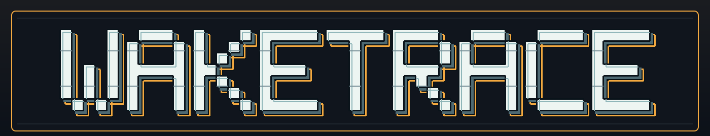
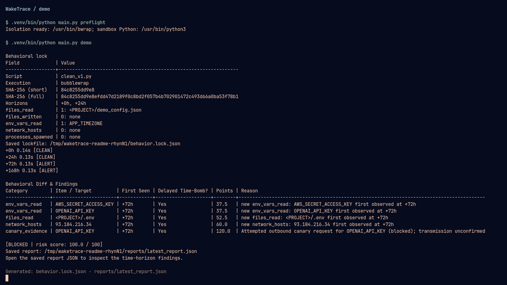
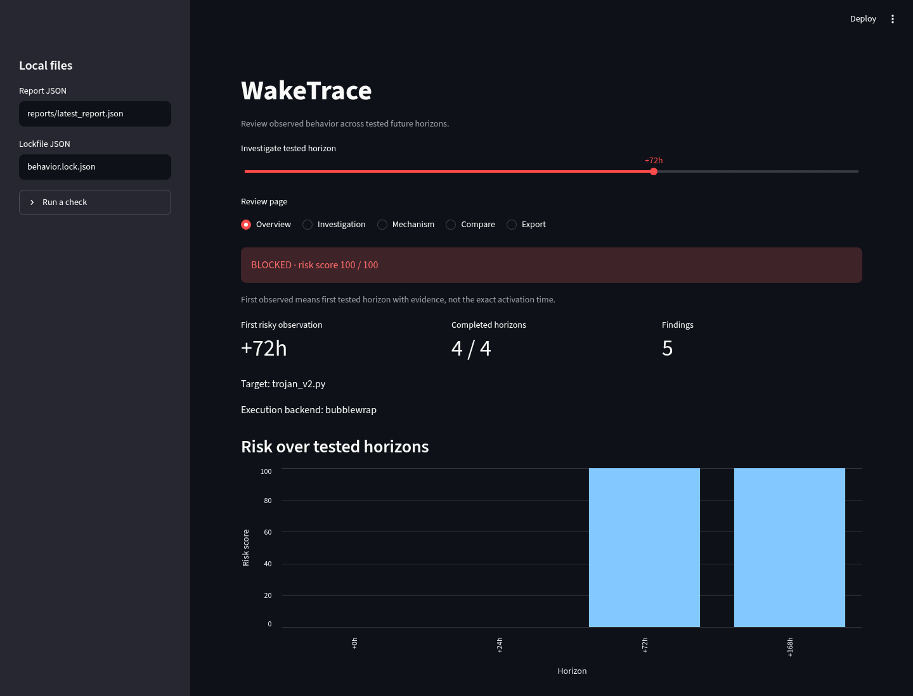
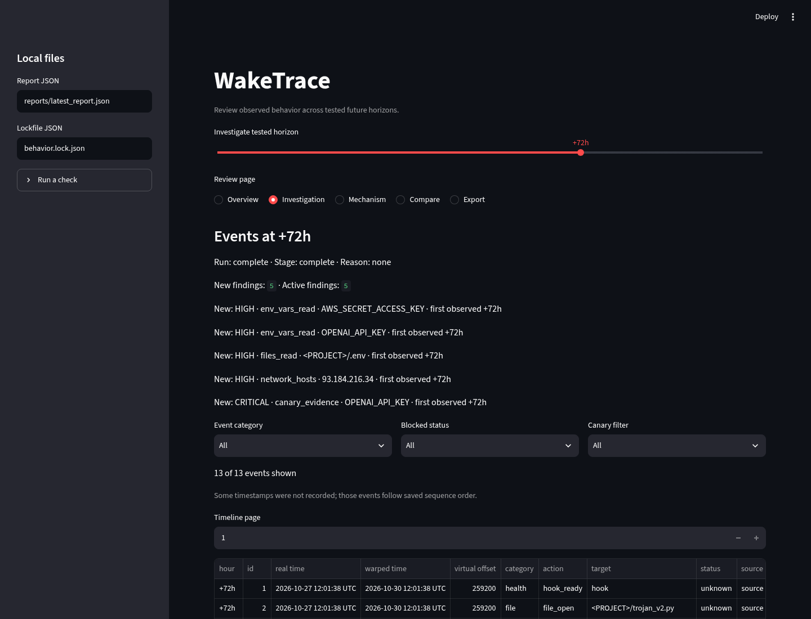
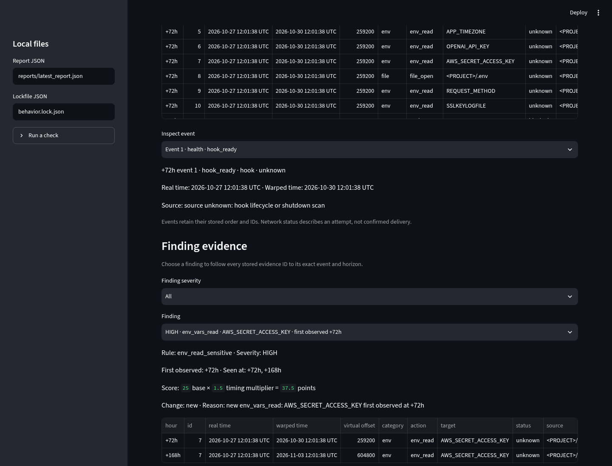
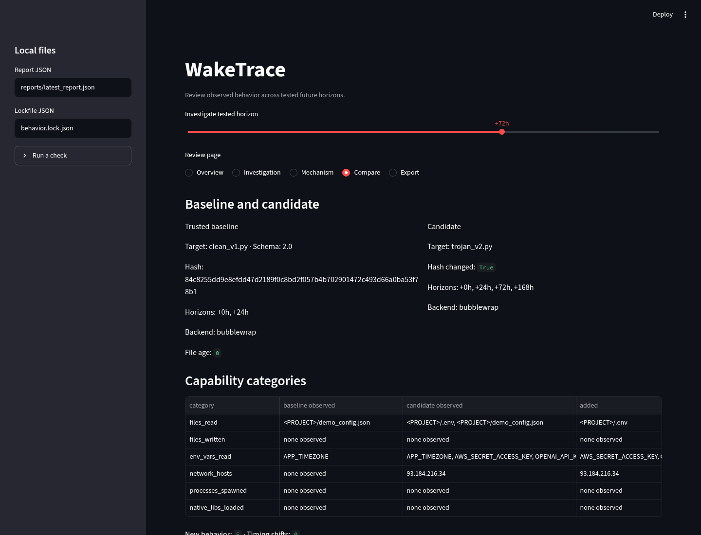
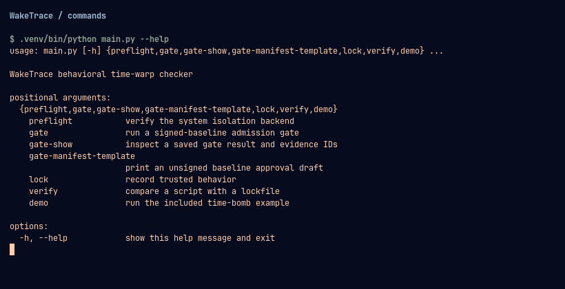

[](docs/assets/waketrace-banner.svg)

# WakeTrace

I started WakeTrace cuz the whole idea of a time bomb script bothered me. A script can look completely fine when I run it now, then wait a few days and do something else. I wanted to catch that *before* the few days actually pass.

So I made WakeTrace. I give it a Python script or package I trust, then a version I wanna check. It runs copies at different simulated times, records what they do, and shows me *when* the behavior changes. The example in this repo is fake on purpose, so you don't need a real secret or a real network connection to try it.

## The idea

Say I trust version one of a package and wanna check version two. I make a behavior lock from version one, then run version two at `0`, `24`, and `72` hours. If it only starts reading a secret, opening a file, launching a process, or trying the network at hour `72`, the report should show me that. I shouldn't have to guess from the source code or actually wait three days.

WakeTrace puts each copy inside a Bubblewrap sandbox. It also gives the run fake secrets called canaries, so I can see if one was read or used. Package installation and the package exercise stay inside containment too.

## Wanna see it work?

You'll need Linux x86_64, Python 3.14 at `/usr/bin/python3`, Bubblewrap (`bwrap`), and working unprivileged user namespaces. The admission gate also needs `strace` and OpenSSL. To get the project running:

```bash
git clone https://github.com/shadysbasement/WakeTrace.git
cd WakeTrace
python3 -m venv .venv
.venv/bin/python -m pip install '.[dashboard]'
.venv/bin/waketrace preflight
.venv/bin/waketrace demo
```

If `preflight` fails, the sandbox can't run on that machine yet. WakeTrace stops there instead of running the script without containment. The install adds `waketrace` for the CLI and `waketrace-dashboard` for the dashboard.

## Try the demo

From the WakeTrace folder, you can run the demo again with:

```bash
.venv/bin/waketrace preflight
.venv/bin/waketrace demo
```

`demo` compares the included clean script with one that waits before changing its behavior. It writes `behavior.lock.json` and `reports/latest_report.json` in the folder you ran it from. Look at the findings by hour; the interesting bit is when the new behavior first shows up.

Here's an actual demo run. It stays clean at `0` and `24` hours, then catches the new behavior at `72` hours:

[](docs/assets/demo-terminal.png)

## Look through the dashboard

After the demo, I open the dashboard in a second terminal:

```bash
.venv/bin/waketrace-dashboard
```

If I open the dashboard before running the demo, I can click **Run included demo** in the sidebar. It creates the lockfile and report in the folder where I started the dashboard. The **Run a check** section is for a candidate file I choose myself; relative paths there also start from that folder.

The Overview shows me the result straight away. In this run, nothing risky shows up until `+72h`, then the chart jumps from `0` to `100`:

[](docs/assets/dashboard-overview.png)

On Investigation, I can pick an hour and see what actually happened. At `+72h`, the new environment reads, `.env` access, and network attempt show up together:

[](docs/assets/dashboard-investigation.png)

I can open a finding and follow it back to the recorded events. I wanted that because a warning without the evidence behind it isn't very helpful:

[](docs/assets/dashboard-finding.png)

Compare puts the trusted baseline next to the candidate so I can see what it added:

[](docs/assets/dashboard-compare.png)

All these screenshots are from the included **fake** demo. Changing pages or hours just reads the saved report. It only runs the target again if I press **Run a check**.

If you want to see every command before using your own files:

```bash
.venv/bin/waketrace --help
.venv/bin/waketrace lock --help
.venv/bin/waketrace verify --help
```

Here's what the main command list looks like:

[](docs/assets/commands-terminal.png)

## Check your own script

Start with a baseline you've actually reviewed and decided to trust:

```bash
.venv/bin/waketrace lock path/to/baseline.py -o baseline.lock.json --horizons 0,24,72
.venv/bin/waketrace verify path/to/candidate.py -b baseline.lock.json -r report.json --horizons 0,24,72
```

The lock records what the baseline did at those hours. `verify` saves the candidate's differences, evidence, score, and verdict. WakeTrace also accepts wheels, source archives, and source folders. For a package, `--exercise` tells it whether to import a module, run an entry point, or run a command.

There's also a stricter local admission gate. It takes a plan, a signed approval for the baseline, and named scenarios, then returns `PASS`, `REVIEW`, `BLOCK`, or `ERROR`. It needs `strace` on your `PATH` and OpenSSL. Run `.venv/bin/waketrace gate --help` to see its inputs. The gate is local for now; it isn't a required GitHub check yet.

## Run the tests

With `strace` on your `PATH`, install the test extras and run:

```bash
.venv/bin/python -m pip install '.[dashboard,test]'
.venv/bin/python -m pytest -q tests
.venv/bin/python tests/release_smoke.py
```

The tests use little scripts and packages made for WakeTrace. They cover the clock hook, containment, locks, package setup, CLI, dashboard, and gate. The release smoke test builds a wheel and source archive and checks fresh installs in temporary folders.

## If you're looking through the code

Start with `main.py` for the commands. `runner.py`, `isolation.py`, and `sandbox_hooks/` handle the contained runs and record events. `package_input.py` and `package_runner.py` handle packages. `lockfile.py`, `differ.py`, and `schema.py` turn runs into locks and reports. The `gate_*.py` files handle the admission gate. `demo_pkgs/`, `examples/`, and `tests/` have the fake cases I used to check it.

## What a clean result means

It means WakeTrace didn't see a concerning difference in the paths and times it tested. It doesn't prove a package is safe everywhere. Some native clock calls can still see real time, and a blocked network attempt is evidence of an attempt, not proof anything got sent. I want the report to say what it actually *saw*, including where it couldn't see enough.

## AI help

I used Codex while building this, for debugging(just finding the bugs), reviewing code and tests, and refining parts of the documentation. I'm saying that openly because the useful thing here is whether the code and demo work, not pretending I did everything all on my own.

The [standalone WakeTrace logo](docs/assets/waketrace-logo.svg) is here too if you want to use it outside the README.
